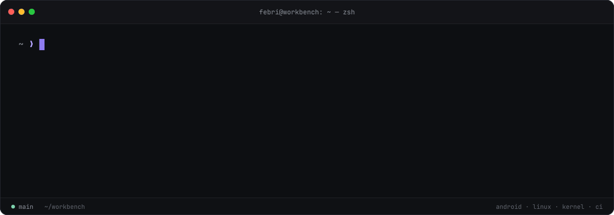
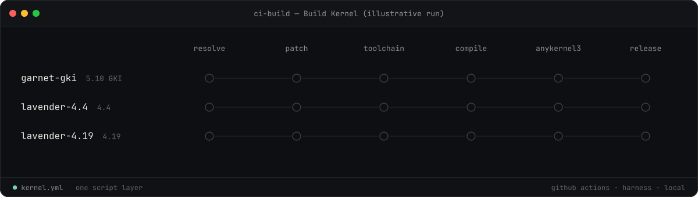
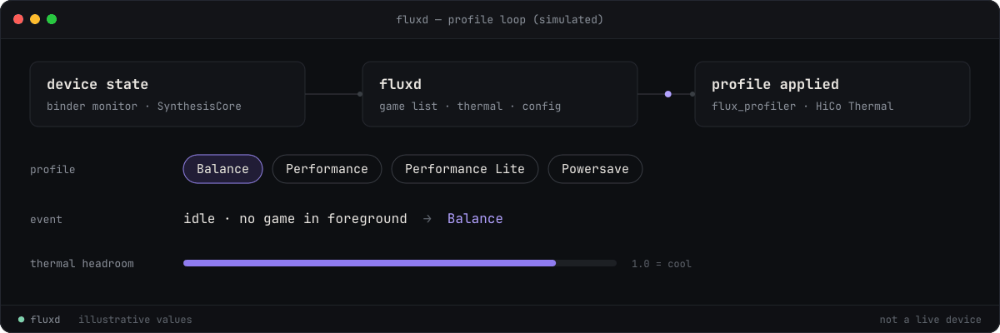
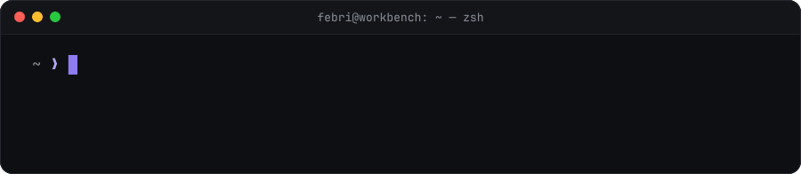

<picture>
  <source media="(prefers-reduced-motion: reduce)" srcset="assets/static/terminal-intro.svg" />
  <source media="(prefers-color-scheme: dark)" srcset="assets/animations/terminal-intro-dark.gif" />
  
</picture>

Sections below are collapsed: select a heading to open it.

<h2>~/about</h2>

I'm **Febri Rahmad Cahya**, an independent developer from Indonesia working on the layers beneath the interface: Android system services, Linux, kernels, and the automation that builds and ships them.

I value engineering that is measurable, understandable, and safe to operate: changes that can be explained, verified, and reverted, not tweaks that only look good in a benchmark.

<h2>~/now</h2> &nbsp;current focus · kernel CI

- **Event-driven device state.** Following Android system state through binder and framework callbacks instead of polling `dumpsys`.
- **Kernel work.** Android kernels for Xiaomi garnet (5.10 GKI) and lavender (4.4 / 4.19), and the kernel framework behind [Zairenkai](https://github.com/FebriCahyaa/Zairenkai).
- **Supply-chain safety for root modules.** Checksums, pinned signing certificates, and provenance checks for anything that runs as root.
- **Reproducible CI.** One shared script layer for GitHub Actions, Harness, and local builds.

<picture>
  <source media="(prefers-reduced-motion: reduce)" srcset="assets/static/kernel-ci.svg" />
  <source media="(prefers-color-scheme: dark)" srcset="assets/animations/kernel-ci-dark.gif" />
  
</picture>

<h2>~/work</h2> &nbsp;Flux · SynthesisCore · HiCo Thermal · ci-build

<picture>
  <source media="(prefers-reduced-motion: reduce)" srcset="assets/static/flux-loop.svg" />
  <source media="(prefers-color-scheme: dark)" srcset="assets/animations/flux-loop-dark.gif" />
  
</picture>

<table>
  <tr>
    <td width="50%" valign="top">
      <a href="https://github.com/FebriCahyaa/Flux"><b>Flux</b></a> 
      Adaptive gaming and battery optimization module for rooted Android. A native C++ daemon follows device state over binder and applies coherent Performance, Performance Lite, Balance, and Powersave profiles. 
      C++ · Magisk, KernelSU, APatch · <a href="https://febricahyaa.github.io/Flux/">project site</a>
    </td>
    <td width="50%" valign="top">
      <a href="https://github.com/FebriCahyaa/SynthesisCore"><b>SynthesisCore</b></a> 
      Event-driven Android system monitor for root daemons. Runs through <code>app_process</code> and publishes foreground app, power, thermal, and battery state to an atomic, <code>inotify</code>-friendly file. 
      Kotlin · Android 9–17 · used by Flux
    </td>
  </tr>
  <tr>
    <td width="50%" valign="top">
      <a href="https://github.com/FebriCahyaa/HiCo"><b>HiCo Thermal</b></a> 
      A Flux add-on that lifts thermal throttling only while a game runs, then restores the stock thermal stack, with a CPU and battery temperature guard. 
      Root module · thermal layer · requires Flux
    </td>
    <td width="50%" valign="top">
      <a href="https://github.com/FebriCahyaa/ci-build"><b>ci-build</b></a> 
      Android kernel CI for the Zairenkai targets. One script layer drives GitHub Actions, Harness, and local builds, and packages each root variant with AnyKernel3. 
      Shell · GitHub Actions · garnet GKI, lavender
    </td>
  </tr>
</table>

<h2>~/devices</h2> &nbsp;Redmi Note 13 Pro 5G · Redmi Note 7 · iPhone 12

<h2>~/toolkit</h2> &nbsp;languages · tools

<table>
  <tr>
    <td>LANGUAGES</td>
    <td></td>
  </tr>
  <tr>
    <td>PLATFORM &amp; BUILD</td>
    <td></td>
  </tr>
  <tr>
    <td>WORKFLOW</td>
    <td></td>
  </tr>
</table>

<h2>~/activity</h2> &nbsp;streak · metrics · latest commit · snake

<table>
  <tr>
    <td align="center" width="25%"><b><!-- METRIC_REPOS_START -->26<!-- METRIC_REPOS_END --></b> public repositories</td>
    <td align="center" width="25%"><b><!-- METRIC_STARS_START -->1<!-- METRIC_STARS_END --></b> stars earned</td>
    <td align="center" width="25%"><b><!-- METRIC_FORKS_START -->4<!-- METRIC_FORKS_END --></b> forks received</td>
    <td align="center" width="25%"><b><!-- METRIC_FOLLOWERS_START -->0<!-- METRIC_FOLLOWERS_END --></b> followers</td>
  </tr>
</table>

**Latest in Flux:** <!-- FLUX_LATEST_START --><code>b75491c</code> · <a href="https://github.com/FebriCahyaa/Flux/commit/b75491c73121cc43025ca4df7c67a297db449423">Merge pull request #13 from FebriCahyaa/claude/webroot-native-evolution</a> · <small>2026-09-29</small><!-- FLUX_LATEST_END -->

<picture>
  <source media="(prefers-color-scheme: dark)" srcset="https://raw.githubusercontent.com/FebriCahyaa/FebriCahyaa/output/github-contribution-grid-snake-dark.svg" />
  <source media="(prefers-color-scheme: light)" srcset="https://raw.githubusercontent.com/FebriCahyaa/FebriCahyaa/output/github-contribution-grid-snake.svg" />
  
</picture>

Cards and counts come from the GitHub REST API through this repository's own workflows. Stars and forks cover original public repositories, not forks; the streak counts commits I authored on their default branches. Metrics last changed <!-- PROFILE_UPDATED_START -->29 Oct 2026, 20:16 WIB<!-- PROFILE_UPDATED_END -->.

<h2>~/contact</h2> &nbsp;Telegram · Instagram · GitHub

The quickest way to reach me is Telegram.

  
  
  

 

<picture>
  <source media="(prefers-reduced-motion: reduce)" srcset="assets/static/terminal-exit.svg" />
  <source media="(prefers-color-scheme: dark)" srcset="assets/animations/terminal-exit-dark.gif" />
  
</picture>

Terminal animations are rendered from Lottie sources in this repository · <a href="docs/profile-automation.md">How this profile is built</a>

