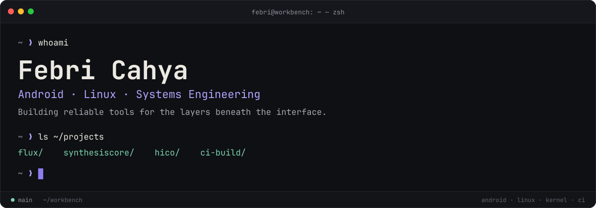

  

  

    
    
    
  

  <h3>Android internals · Linux systems · Kernel engineering · Developer tooling</h3>
  
Building practical tools that make devices more observable, configurable, and reliable.

  

    <a href="#featured-work">Featured work</a> ·
    <a href="#toolbox">Toolbox</a> ·
    <a href="#github-activity">GitHub activity</a> ·
    <a href="#connect">Connect</a>
  

---

## 👋 About me

I'm **Febri Rahmad Cahya**, an independent developer interested in the layers beneath the interface: Android system services, Linux, kernel development, thermal and performance control, and automation infrastructure.

- **Systems:** Android internals, Linux, shell tooling, device integration, and performance observability.
- **Android:** Java/Kotlin services, `app_process`, root-module integration, and system-state monitoring.
- **Kernel & build engineering:** kernel source workflows, patch validation, toolchain setup, and CI automation.
- **Developer experience:** maintainable tooling, clear diagnostics, reproducible builds, and documentation that stays useful.

I value engineering that is measurable, understandable, and safe to operate—not tweaks that merely look impressive in a benchmark.

## 🧭 Featured work

<table>
  <tr>
    <td width="50%" valign="top">
      <h3>⚡ <a href="https://github.com/FebriCahyaa/Flux">Flux</a></h3>
      
Android performance-profile tooling for supported root environments, designed around configurable modes and system-aware behavior.

      
ANDROID · ROOT MODULE · PERFORMANCE

    </td>
    <td width="50%" valign="top">
      <h3>🧠 <a href="https://github.com/FebriCahyaa/SynthesisCore">SynthesisCore</a></h3>
      
A Java/Kotlin system daemon using <code>app_process</code> to observe device state such as charging and thermal signals.

      
JAVA · KOTLIN · SYSTEM SERVICES

    </td>
  </tr>
  <tr>
    <td width="50%" valign="top">
      <h3>🌡️ <a href="https://github.com/FebriCahyaa/HiCo">HiCo</a></h3>
      
Thermal knowledge and ingestion tooling for organizing device profiles, configuration artifacts, and source relationships.

      
PYTHON · THERMAL DATA · TOOLING

    </td>
    <td width="50%" valign="top">
      <h3>🛠️ <a href="https://github.com/FebriCahyaa/ci-build">Kernel CI Build</a></h3>
      
Build and validation automation for kernel workflows, patch sets, toolchains, and packaging handoffs.

      
GITHUB ACTIONS · SHELL · KERNELS

    </td>
  </tr>
</table>

Project descriptions are intentionally concise; open each repository for the current implementation, compatibility notes, and status.

## 🧰 Toolbox

  
<strong>Languages & runtime</strong>

   
  

    
    
    
    
    
    
  

  
<strong>Android, Linux & build systems</strong>

   
  

    
    
    
    
    
    
  

  
<strong>Source control & automation</strong>

   
  

    
    
    
    
  

## 📈 GitHub activity

<table>
  <tr>
    <td align="center" width="25%">
      <strong>Public repositories</strong> 
      <h2><!-- METRIC_REPOS_START -->23<!-- METRIC_REPOS_END --></h2>
    </td>
    <td align="center" width="25%">
      <strong>Stars earned</strong> 
      <h2><!-- METRIC_STARS_START -->1<!-- METRIC_STARS_END --></h2>
    </td>
    <td align="center" width="25%">
      <strong>Forks received</strong> 
      <h2><!-- METRIC_FORKS_START -->4<!-- METRIC_FORKS_END --></h2>
    </td>
    <td align="center" width="25%">
      <strong>Followers</strong> 
      <h2><!-- METRIC_FOLLOWERS_START -->0<!-- METRIC_FOLLOWERS_END --></h2>
    </td>
  </tr>
</table>

Metrics are refreshed by GitHub Actions and cover public profile data. Stars and forks are summed across original public repositories, excluding forks owned by this account.

  
  

  

> **How to read these cards:** third-party stats cards can be delayed or temporarily unavailable. The repository metrics above are generated directly from the GitHub API by this repository's own workflow.

## 🔭 Latest Flux update

<!-- FLUX_LATEST_START --><code>b75491c</code> · <a href="https://github.com/FebriCahyaa/Flux/commit/b75491c73121cc43025ca4df7c67a297db449423">Merge pull request #13 from FebriCahyaa/claude/webroot-native-evolution</a> · <small>2026-09-29</small><!-- FLUX_LATEST_END -->

## 🐍 Contribution trail

  <picture>
    <source media="(prefers-color-scheme: dark)" srcset="https://raw.githubusercontent.com/FebriCahyaa/FebriCahyaa/output/github-contribution-grid-snake-dark.svg" />
    <source media="(prefers-color-scheme: light)" srcset="https://raw.githubusercontent.com/FebriCahyaa/FebriCahyaa/output/github-contribution-grid-snake.svg" />
    
  </picture>

## 🕒 Profile automation

| Signal | Value |
|:--|:--|
| Last refreshed | <!-- PROFILE_UPDATED_START -->11 Oct 2026, 13:01 WIB<!-- PROFILE_UPDATED_END --> |
| Refresh cadence | Every 6 hours, plus manual dispatch |
| Workflow | [Profile refresh](https://github.com/FebriCahyaa/FebriCahyaa/actions/workflows/profile-refresh.yml) |
| Quality checks | [Validate profile](https://github.com/FebriCahyaa/FebriCahyaa/actions/workflows/validate-profile.yml) |

The README refresh updates the profile metrics and latest Flux commit. It does not claim that I'm online or available based on a clock, because a scheduled workflow cannot reliably infer my availability.

## 🤝 Connect

  
  
  

---

  Designed with a Material 3 Expressive-inspired visual language · Maintained with GitHub Actions · Built by Febri Cahya

